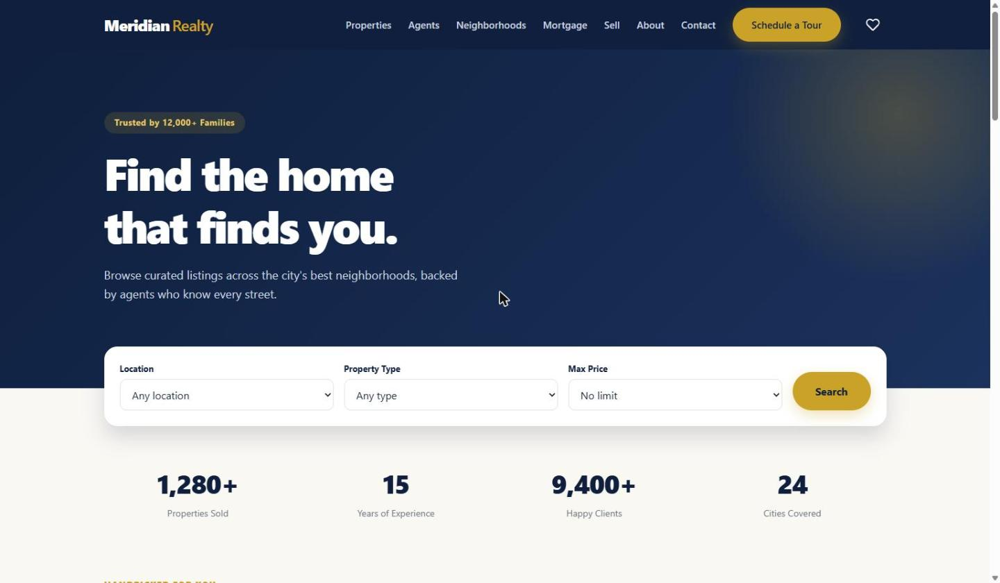

# Meridian Realty - Multi-page Real Estate Website Template

A free, responsive real estate website built with plain HTML5, CSS3 and JavaScript. No frameworks, no build step. It has every page a brokerage needs: listings with filters, property details, agents, a mortgage calculator, a seller estimate and tour scheduling.



**[Live demo](https://lenivalestevao.github.io/real-estate-landing-page/)**

## Pages

All pages run in a single `index.html` and are routed with the URL hash (for example `#/properties`), so it works on any static host such as GitHub Pages.

| Page | Route | What it does |
| --- | --- | --- |
| Home | `#/` | Hero with search, animated stats, featured properties carousel, why us, neighborhoods, agents and reviews carousels, call to action |
| Properties | `#/properties` | Search, location, type, status, max price and bedrooms filters plus sorting |
| Property | `#/property/1` | Gallery, specs, description, features, map placeholder, payment estimate, agent card and inquiry form |
| Agents | `#/agents` and `#/agent/1` | Team page and agent profiles with their listings and contact form |
| Neighborhoods | `#/neighborhoods` | Area guides that link to filtered listings |
| Mortgage | `#/mortgage` | Live monthly payment calculator (price, down payment, rate, term) |
| Sell | `#/sell` | Free home value estimate form and how selling works |
| Saved | `#/favorites` | Properties saved with the heart button |
| Schedule a tour | `#/tour` | Tour request form (in person or video) and confirmation page |
| About, Contact, FAQ | `#/about` `#/contact` `#/faq` | Content pages with accordion and contact form |
| Privacy, Terms | `#/privacy` `#/terms` | Sample legal pages |
| 404 | any unknown route | Friendly not-found page |

It also includes a mobile off-canvas menu, toast messages and a saved-properties counter in the header.

## Structure

```
index.html   # page shell: header and footer
style.css    # all styles, responsive down to small phones
script.js    # router, pages, demo listings, filters, calculator, forms
```

## Customize

- **Listings, neighborhoods, agents and reviews:** edit the `P`, `LOCS`, `AGENTS` and `REVIEWS` arrays at the top of `script.js`.
- **Colors:** change the CSS variables in `:root` at the top of `style.css` (the accent is `--gold`).
- **Brand and text:** replace "Meridian Realty" in `index.html` and the copy inside the page functions in `script.js`.
- **Real data:** the listings are a local array, so connect them to your own API or MLS feed when you are ready.

Saved properties and tour requests are kept in `localStorage`. Forms and estimates are demos only, so add a real back end before going live.

## License

MIT
